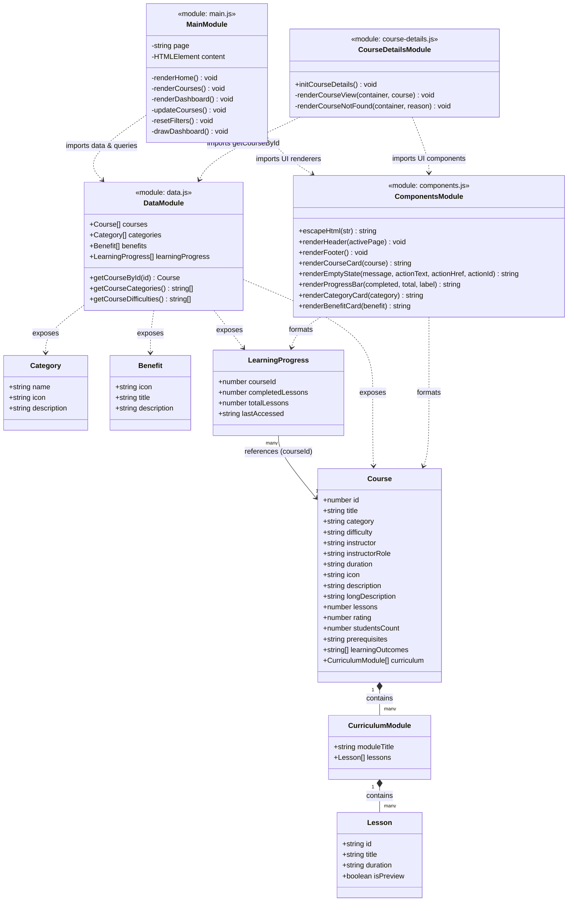

# LearnUp EdTech — UML Class & Module Architecture

This document documents the modular JavaScript architecture, entity relationships, and data models of the **LearnUp** EdTech application using Mermaid class diagrams.

---

## 1. Architecture Overview

LearnUp is structured into four decoupled ES modules:
- **`data.js`**: Single source of truth for fictional sample courses, categories, benefits, and student learning progress.
- **`components.js`**: Pure presentation module exporting reusable HTML rendering functions and accessibility wrappers.
- **`main.js`**: Page controller managing routing, home page rendering, catalog search/filter interactions, and dashboard metrics.
- **`course-details.js`**: Specialized page controller reading URL query parameters, looking up courses, rendering syllabi, and managing frontend enrollment.

---

## 2. Mermaid Class & Module Diagram

---

## 3. Module Responsibilities Summary

| Module | File Path | Primary Responsibilities |
|---|---|---|
| **Data** | [`js/data.js`](../js/data.js) | Central in-memory repository for course catalog, curriculum breakdowns, difficulty levels, categories, benefits, and user progress. Strictly non-persistent. |
| **Components** | [`js/components.js`](../js/components.js) | Reusable UI templates for headers, footers, course cards, progress bars, category tiles, empty state messaging, and XSS sanitization (`escapeHtml`). |
| **Main Controller** | [`js/main.js`](../js/main.js) | Detects active page via `data-page`. Renders Home, Courses, and Dashboard views. Manages real-time search, category/difficulty filtering, and dashboard statistics. |
| **Course Details** | [`js/course-details.js`](../js/course-details.js) | Isolates course details view. Validates `?id=` query parameter, renders syllabus accordion and learning outcomes, and binds interactive frontend enrollment. |
