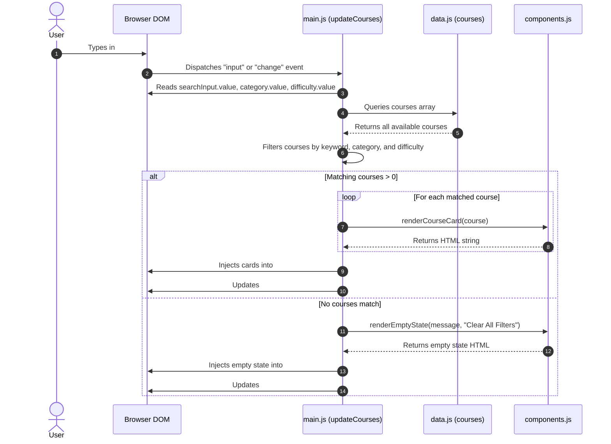
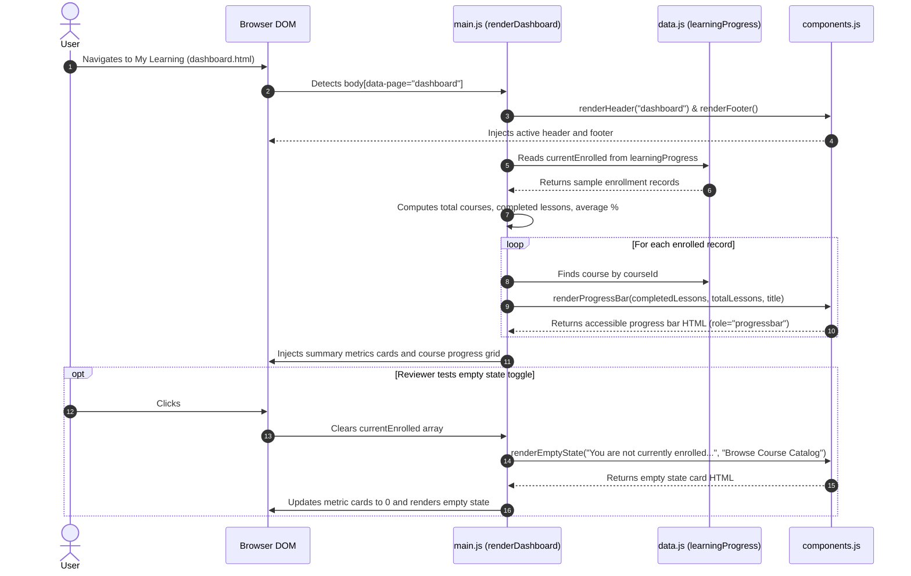

# LearnUp EdTech — UML Sequence Diagrams

This document illustrates the three key user workflows within **LearnUp** using Mermaid sequence diagrams:
1. **Searching and Filtering Courses** (`courses.html`)
2. **Opening Course Details and Enrolling** (`course-details.html`)
3. **Viewing Dashboard Learning Progress** (`dashboard.html`)

---

## 1. Course Search and Filtering Flow

Shows how input events from the user immediately filter the catalog without server requests.



---

## 2. Course Details Lookup & Frontend Enrollment Flow

Shows how course IDs are extracted from the URL, validated, rendered, and how frontend enrollment state is toggled.

```mermaid
sequenceDiagram
    autonumber
    actor User
    participant Browser as Browser Window
    participant Details as course-details.js
    participant Data as data.js
    participant Comp as components.js

    User->>Browser: Clicks "View Course" link (./course-details.html?id=1)
    Browser->>Details: Loads module and executes initCourseDetails()
    Details->>Comp: renderHeader("courses") & renderFooter()
    Comp-->>Browser: Injects shared navigation and footer
    Details->>Browser: Reads window.location.search (?id=1)
    Details->>Data: getCourseById(1)

    alt Valid Course Found
        Data-->>Details: Returns course object
        Details->>Browser: Updates document.title ("Web Development Fundamentals | LearnUp")
        Details->>Browser: Injects breadcrumb, hero header, outcomes, syllabus & enrollment card
        User->>Browser: Clicks #enroll-btn ("Enroll Now • Free")
        Browser->>Details: Fires "click" event listener
        Details->>Browser: Disables button, sets label to "✓ Enrolled (In Progress)"
        Details->>Browser: Displays friendly enrollment celebration alert with link to My Learning
    else Invalid or Missing Course ID
        Data-->>Details: Returns undefined
        Details->>Comp: renderEmptyState("Course not found...", "Browse All Courses")
        Comp-->>Details: Returns error message HTML
        Details->>Browser: Injects friendly error state into #page-content
    end
```

---

## 3. Dashboard Progress & Empty State Simulation Flow

Shows how student enrollment data is computed into percentages, rendered as accessible progress bars, and how the empty state can be tested.


